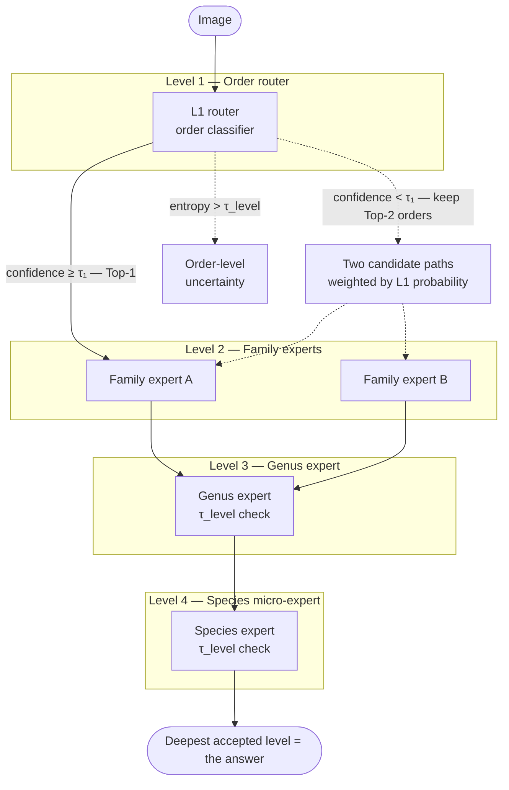

# Open Insect ID v2

On-device insect identification built on a **hierarchical Vision Mixture-of-Experts
(MoE)** — a 4-level taxonomic cascade (Order → Family → Genus → Species) trained on
global GBIF data and exported to **TFLite** for Android/Kotlin inference.

This repository contains the **model + data + training + export** Python package and
its **Kaggle notebooks**. The Android app lives in a separate repository.

## Why a hierarchical MoE instead of flat classification?

A single softmax over tens of thousands of insect species is dominated by the
long tail and forces every image through one giant classifier. Instead we route
each image down a cascade of small specialists:



Each expert only discriminates between **siblings**, so sub-problems stay small
and edge-friendly. A confidence/entropy check at every level lets the pipeline
stop early and return the deepest *certain* taxon instead of guessing — the
`-.-` edges above are the fallback paths (Top-2 order routing and early
rejection) that make the cascade robust to a wrong first guess.

## Repository layout

```
configs/               # data + model YAML (GBIF filters, H3, backbones, τ thresholds)
src/
  data_pipeline/       # GBIF ingestion, DuckDB/H3 spatial cleaning, async image
                       #   download, automated curation
  models/              # MobileNetV4 UIB backbones, taxonomy tree, per-node experts,
                       #   Top-K router, the 4-level HierarchicalMoE cascade
  training/            # hierarchical CE + focal + taxonomic cost-matrix loss,
                       #   BioCLIP distillation, dataset, Mixup/CutMix, Trainer
  export/              # per-module ONNX, INT8 PTQ, TFLite conversion
notebooks/             # runnable Kaggle entry points (data → train → export)
tests/                 # unit tests covering all of the above
scripts/               # notebook generator
```

## Backbones

The default on-device backbone is a **MobileNetV4-style UIB stack**
(`mnv4_small` / `mnv4_medium`) — depthwise-separable, quantization-friendly,
strong accuracy/latency on CPU/NPU.

**On MobileNetV5** (released June 2025): it is a single ~300M-parameter encoder
built for Gemma 3n (768×768 inputs, sparse attention, RMSNorm/GELU). The only
public pretrained weights are under the **Gemma license** and its classification
heads are marked WIP. It is not a drop-in replacement for small edge experts, so
MobileNetV4 remains the default. A `timm:<model>` seam is provided for
experimentation:

```python
from src.models import build_backbone
backbone = build_backbone("timm:mobilenetv5_base")   # requires `pip install timm`
```

## Quickstart

### Run the tests (CPU)

```bash
python -m venv .venv && .venv/bin/pip install -e ".[test]"
.venv/bin/python -m pytest tests/ -q
```

### Run on Kaggle (the intended workflow)

The notebooks under `notebooks/` are the executable entry points:

| Notebook | Purpose | Accelerator |
|----------|---------|-------------|
| `01_data_pipeline.ipynb` | GBIF ingest → DuckDB/H3 clean → async download → curation → manifest | CPU |
| `02_train_moe.ipynb` | build tree → MoE + loss → train (± distillation) → checkpoints | **GPU** |
| `03_export_tflite.ipynb` | load checkpoints → per-module ONNX → INT8 → `.tflite` bundle | CPU |

Each notebook installs the package from GitHub (`GITHUB_REPO` at the top of
`01`). To run end-to-end, attach the manifest/image/checkpoint artifacts
produced by one notebook as an input dataset to the next.

### Use as a library

```python
from src.models import HierarchicalMoE, TaxonomyTree
from src.training import CombinedTaxonomicLoss, build_dataloaders
from src.export import export_moe

tree = TaxonomyTree.load("taxonomy.json")
model = HierarchicalMoE(tree, backbone_name="mnv4_small",
                        tau_order=0.85, tau_levels=(0.85, 0.80, 0.70, 0.50))
res = model.route(image_tensor)      # inference on one image
print(res.describe())                # deepest certain taxon + confidence
```

## Key ideas from the engineering plan

- **Hierarchical loss** — per-level weighted CE so an *order* mistake costs far
  more than a *species* mistake, plus a **taxonomic cost-matrix** penalty driven
  by tree distance (LCA depth) between predicted and true species.
- **Focal loss** on genus/species to survive the long-tail distribution.
- **Top-K order routing + per-level rejection** to avoid cascade errors and to
  report "Genus certain, species uncertain" style fallbacks.
- **DuckDB + Uber H3** for world-scale, RAM-safe occurrence cleaning and spatial
  outlier (mislabelled / lab specimen) removal.
- **BioCLIP distillation** to transfer biologically-informed features into the
  compact edge experts (optional, needs `transformers` + GPU).
- **INT8 PTQ + TFLite** for NNAPI/Hexagon on-device inference.

## Dataset

The curated, world-scale insect image dataset is published on Kaggle — see
[`docs/dataset_card.md`](docs/dataset_card.md).

## License

MIT (see `LICENSE`). Note: any weights distilled from BioCLIP or MobileNetV5
inherit their upstream licenses — check before redistributing.
